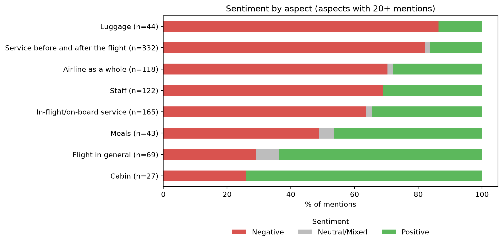

# Airline Reviews: Aspect-Based Sentiment Analysis

Sentence-level analysis of airline passenger reviews. Each sentence is labelled with the aspect it talks about (staff, luggage, meals, …) and a sentiment score. This project cleans a messy raw CSV, reshapes it, compares four airlines at the review level, and trains a baseline sentiment classifier.

> Dataset source: _add link / citation here_

## Dataset

| | |
|---|---|
| Airlines | Aeroflot, China Southern, Qatar Airways, Turkish Airlines |
| Reviews | 100 (25 per airline) |
| Sentences | 736 |
| Aspects | Luggage, Staff, In-flight/on-board service, Airline as a whole, Service before and after the flight, Flight in general, Comfort while waiting, Meals, Cabin, Transportation to the plane |

Each aspect column holds a value from 0 to 5.

**Label interpretation (inferred, not documented):**

| Value | Meaning | Grouped as |
|---|---|---|
| 0 | Aspect not mentioned | – |
| 1–2 | Negative / very negative | Negative |
| 3 | Neutral or mixed | Neutral/Mixed |
| 4–5 | Positive / very positive | Positive |

I derived this by reading example sentences for each value. It is my interpretation. Please verify it against the dataset's own documentation if available.

## Data cleaning

The raw CSV had several problems:

1. **Malformed rows.** 232 rows had the entire line stuffed into the `Airline` column (extra quoting), with every other column empty. I re-parsed them with Python's `csv` module and merged them back (736 rows, 14 columns).
2. **Stray `;` characters** in the last header and values (e.g. `Transportation to the plane;;`, `0;;`). Stripped, and all aspect columns converted to numbers.
3. **Missing labels.** 4 rows had null aspect labels and were set to 0.
4. **Text cleaning** into a `corpus` column: remove non-letters, lowercase, remove stopwords (keeping negations such as *no, not, never*), lemmatize with NLTK.
5. **Reshape to long format.** One row per (sentence, aspect) where the aspect is mentioned: 945 aspect mentions.

## Findings

### Sentiment by aspect (share of mentions, aspects with 20+ mentions)



- **Service before and after the flight** is the largest topic (332 mentions) and about 78% negative.
- **Luggage** is about 86% negative but has only 44 mentions.
- **Cabin** (about 74% positive) and **Flight in general** (about 71% positive) are the most positive aspects.
- Meals are split roughly evenly.
- Transportation to the plane and Comfort while waiting have too few mentions to interpret.

### Airline comparison: share of reviews (of 25) with a negative mention

| Aspect | Aeroflot | China Southern | Qatar | Turkish |
|---|---|---|---|---|
| Service before/after flight | 16% | 52% | 68% | 84% |
| Airline as a whole | 0% | 28% | 56% | 80% |
| Staff | 4% | 16% | 32% | 56% |
| In-flight service | 12% | 20% | 16% | 36% |
| Luggage | 0% | 4% | 24% | 16% |

**Why review-level?** Sentence counts are dominated by a few long reviews: one Turkish review has 102 sentences (about 32% of that airline's 321). Counting each review once avoids letting one reviewer drive the result. Removing that review does not change the conclusion (Turkish remains about 94% negative across all labelled mentions; Aeroflot about 13%).

**Reading this carefully.** With 25 reviews per airline, one review equals 4 percentage points. Large gaps (Aeroflot vs Turkish) are meaningful for this sample. Small gaps are not. This is a sample, not a ranking of the airlines.

### Common words

Negative mentions are dominated by *no, not, passenger, service, customer, airport, hour, rude, crew, ticket*. Positive mentions by *good, service, food, staff, comfortable, friendly, meal*. The word *mask* appears in both, which suggests the reviews include mask-rule disputes.

## Sentiment classifier

Predicts whether a sentence is Negative or Positive. Neutral/Mixed was dropped (too few examples), as were sentences with contradictory labels across aspects: 575 sentences remain (396 Negative, 179 Positive).

- **Model:** TF-IDF (1–2-grams) + logistic regression with balanced class weights.
- **Evaluation:** 5-fold `GroupKFold`, grouped by review so sentences from the same review never appear in both train and test.
- **Majority-class baseline:** 0.69 accuracy.

| Input | Accuracy | Macro-F1 |
|---|---|---|
| Cleaned `corpus` | 0.765 | 0.721 |
| **Raw sentence** | **0.788** | **0.744** |
| Aspect + raw sentence | 0.772 | 0.734 |

Confusion matrix for the `corpus` model (rows = true, columns = predicted):

|  | Pred. Negative | Pred. Positive |
|---|---|---|
| **True Negative** | 334 | 62 |
| **True Positive** | 73 | 106 |

The raw-sentence version is best, probably because it keeps negation words. Differences of about 2 points on 575 sentences are close to noise.

### Error analysis

- **Context-dependent sentences.** Many errors are neutral narrative sentences (e.g. *"I want your name and passport number."*) labelled Positive. Their label depends on the surrounding story, which a sentence-level model cannot see.
- **Negation and sarcasm.** *"Cabin crew not helpful or welcoming"* is predicted Positive; *"treated to the most amazing conversation"* is sarcastic.
- **Possible annotation noise.** Some labels look inconsistent with their sentence, which caps the achievable accuracy.

## Limitations

- Small sample: 100 reviews, 575 sentences in the classifier.
- Label scale is inferred (see above).
- Reviews are not guaranteed to be representative of each airline.
- Sentence-level modelling ignores review context.
- Sentences with several aspects share one text but carry different labels per aspect.

## Possible next steps

- Sentence embeddings (e.g. `sentence-transformers`) instead of TF-IDF.
- Model the surrounding sentences (review context) as input.
- Predict aspect and sentiment together.
- Verify the label scale and validate a sample of labels manually.

## Setup

```bash
python -m venv venv
venv\Scripts\activate          # Windows
# source venv/bin/activate     # macOS / Linux
pip install pandas matplotlib seaborn nltk scikit-learn jupyter ipykernel
python -m ipykernel install --user --name=airline-venv --display-name "Python (airline-venv)"
```

Select the **Python (airline-venv)** kernel in Jupyter or VS Code, then run the notebook top to bottom. NLTK downloads `stopwords` and `wordnet` on first run.

## Project structure

```
├── data/        # raw CSV (check the dataset's licence before committing it)
├── images/      # saved charts
├── notebook.ipynb
├── requirements.txt
└── README.md
```

Create `requirements.txt` with `pip freeze > requirements.txt`.
